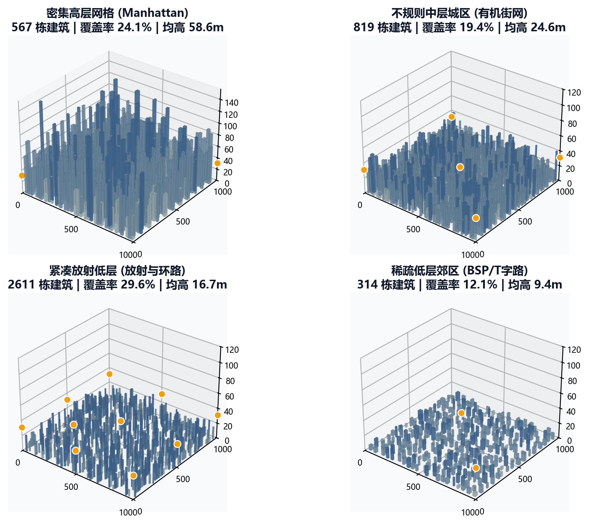
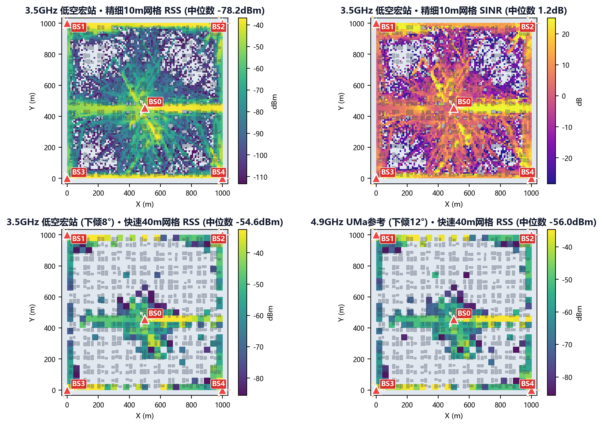
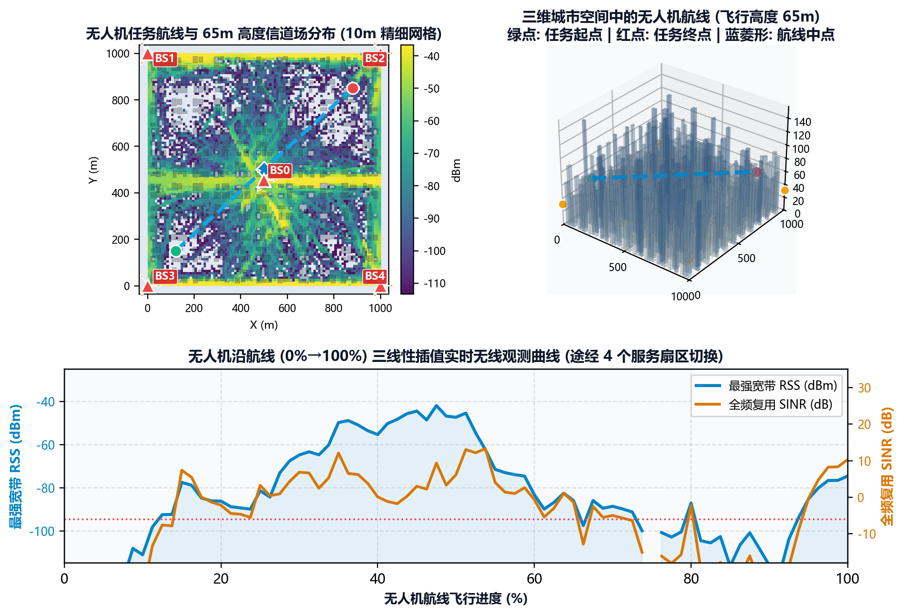

# AeroCity-RT

**AeroCity-RT** 是一个确定性程序化三维城市生成、低空/城市无线基站配置与离线射线追踪（Sionna RT）可视化工具。项目提供开箱即用的本地三维 Web 交互界面与命令行工具，支持城市几何生成、基站与扇区部署、空间无线信道热力图计算、无人机轨迹信号查询及标准化三维场景资产导出。

---

## 核心功能

- **程序化三维城市生成**
  - 内置**密集高层网格**、**不规则中层城区**、**紧凑放射低层**、**稀疏低层郊区**四类典型城市形态预设。
  - 支持 Manhattan 网格、有机不规则街区、BSP/T 字路、放射与环路四种道路拓扑，并支持自定义城市尺寸、道路间距/宽度、建筑覆盖率、密度、高度分布与尺寸范围。
  - 自动执行边界检查、道路避让、建筑间距碰撞检测与自由空间连通性验证，基于固定随机种子保证场景 100% 可复现。
- **低空与城市基站参数化配置**
  - 内置低频广域通信（700 MHz）、Sub-6 GHz 低空宏站（3.5 GHz）、4.9 GHz 通感一体实验站、毫米波通感实验站（26 GHz）四类低空预设，以及 3GPP UMa / UMi 街谷校准参考预设。
  - 支持道路网格、规则屋顶、随机屋顶等站点部署策略，可自由配置站点密度、天线高度、载波频率、带宽、发射功率、下倾角、扇区数量/方位角及 3GPP 天线阵列模型。
  - 自动记录预设来源、证据等级与参数修改差异（`modified_fields`），便于实验溯源与参数审计。
- **Sionna RT 离线无线信道地图（可选）**
  - 集成 NVIDIA Sionna RT 射线追踪后端，提供快速（40 m）、平衡（20 m）、精细（10 m）三档计算质量。
  - 生成指定飞行高度层面的**最强宽带 RSS** 与**全频复用 SINR** 空间热力图，支持自适应（P5–P95）与固定色标切换。
- **三维交互视图与无人机轨迹观测**
  - 基于 Three.js 提供三维城市旋转、缩放、俯视切换、图层显隐控制与建筑/基站属性点选检查。
  - 支持虚拟无人机沿任务航线拖动或自动播放，实时查询当前空间三维坐标处的最强宽带 RSS、全频复用 SINR、服务小区与连接状态。
- **标准化资产导出**
  - 一键导出 `config.json`（完整输入配置）、`scene.json`（结构化场景语义数据）、`base_station_manifest.json`（基站与逻辑扇区清单）和 `scene.obj`（Wavefront OBJ 三维网格模型）。

---

## 效果预览

### 1. 多形态程序化三维城市与密度建模
支持密集高层网格、不规则中层城区、紧凑放射低层与稀疏低层郊区四类典型城市预设，自动完成道路避让与建筑碰撞检测：



### 2. 多基站配置与 Sionna RT 空间无线热力图
支持不同频段（700 MHz / 3.5 GHz / 4.9 GHz / 26 GHz）、下倾角与网格精度（40 m / 20 m / 10 m）的宽带 RSS 与全频复用 SINR 空间分布计算，完整展示各站点（`BS0`–`BS4`）及三扇区指向：



### 3. 无人机低空轨迹规划与实时无线观测
基于离线三维路径增益张量执行空间三线性插值，实时返回无人机沿途各位置的宽带 RSS、全频复用 SINR、服务扇区切换及连接中断状态：



---

## 环境要求

- **操作系统**：Windows 10 / 11（64 位）或 Linux / macOS
- **Python 版本**：Python 3.10 及以上
- **可选硬件（用于 Sionna RT 射线追踪）**：兼容 CUDA / OptiX 的 NVIDIA 显卡及最新显卡驱动（仅使用三维城市与基站生成可视化时无需 GPU）

---

## 安装指南

### 方式一：Windows 一键安装（推荐）

1. 确保系统已安装 64 位 Python 3.10，且终端可执行 `py -3.10`。
2. 如需启用 Sionna RT 无线计算，请提前配置好 NVIDIA 显卡驱动与 CUDA/OptiX 环境。
3. 双击运行项目根目录下的 `InstallVisualizer.bat`。
4. 等待终端显示 `Installation completed.`（脚本会自动在项目目录下创建 `.venv-sionna310` 虚拟环境并安装全部依赖）。

### 方式二：使用 pip 手动安装

```bash
# 创建并激活虚拟环境
python -m venv .venv
# Windows 激活: .venv\Scripts\activate
# Linux/macOS 激活: source .venv/bin/activate

# 仅安装城市生成与三维可视化核心依赖
pip install -e .

# 或同时安装 Sionna RT 射线追踪依赖
pip install -e ".[rt]"
```

---

## 快速开始

### 1. 启动 Web 可视化器

**Windows 快捷启动**：双击运行 `scripts\StartVisualizer.bat`。

**命令行启动**：

```bash
wireless-city-viewer
# 或直接通过模块运行
python -m wireless_city_factory.web_app --host 127.0.0.1 --port 8765
```

启动后浏览器会自动打开本地交互页面（默认地址为 `http://127.0.0.1:8765/`；若端口被占用会自动顺延并在终端打印实际地址）。按 `Ctrl+C` 或关闭终端窗口即可停止服务。

### 2. 基本使用流程

1. **选择城市与基站预设**：在左侧面板选择城市预设（如“密集高层网格”）与基站预设（如“Sub-6 GHz 低空宏站”），或调整随机种子与自定义参数。
2. **生成三维城市**：点击左下角 **“生成三维城市”**，在右侧三维视图中旋转、缩放、切换图层或点击建筑与基站查看详细属性。
3. **计算无线热力图（可选）**：切换到 **“无线与无人机”** 标签页，开启 **“启用 Sionna RT”**，首次体验建议选择“快速预览”，点击 **“生成城市并计算无线”**。
4. **轨迹播放与信号查询**：无线地图就绪后，可切换宽带 RSS / 全频复用 SINR 热力图与色标模式；拖动轨迹滑块或点击 **“播放轨迹”**，右上角面板将实时显示无人机当前位置的无线观测数据。
5. **导出结果**：点击顶部工具栏的 **配置 / 场景 / 基站 / OBJ** 按钮下载标准结果文件。

### 3. 命令行批量/配置生成（可选）

除 Web 界面外，也可以使用 `wireless-city` 命令行工具根据 YAML 配置文件直接生成场景：

```bash
# 仅生成城市与基站场景
wireless-city generate --config configs/city_only.yaml

# 生成城市并运行 Sionna RT 快速验证
wireless-city generate --config configs/city_radio_smoke.yaml
```

---

## 输出目录说明

Web 可视化器生成的运行结果默认保存在用户本地数据目录，不会污染源码仓库：

- **Windows**：`%LOCALAPPDATA%\WirelessCityFactory\outputs\<run_id>`
- **Linux / macOS**：`~/.wireless_city_factory/outputs/<run_id>`
- 如需自定义输出路径，可在启动前设置环境变量 `WCF_VISUALIZER_OUTPUT`。

在相同生成器契约版本下，相同的配置参数与随机种子会计算得到相同的运行指纹并自动复用已有结果。

---

## 项目结构

```text
├── configs/
│   ├── base_station_profiles/      # 低空通信/通感预设与 3GPP UMa/UMi 校准参考配置
│   ├── city_only.yaml              # 命令行城市生成示例配置
│   └── city_radio_smoke.yaml       # 命令行城市 + Sionna RT 冒烟测试配置
├── docs/
│   ├── base_station_presets.md     # 基站预设参数来源、证据等级与适用场景说明
│   └── visualizer.md               # 可视化器详细操作手册与参数字典
├── scripts/
│   └── StartVisualizer.bat         # Windows 日常快速启动脚本
├── src/wireless_city_factory/
│   ├── web/                        # 前端三维交互界面 (Three.js + Lucide)
│   ├── base_stations.py            # 基站站点与逻辑扇区生成与校验
│   ├── city.py                     # 程序化道路网络与建筑布局生成
│   ├── cli.py                      # 命令行入口 (wireless-city)
│   ├── config.py                   # 配置解析、参数校验与指纹计算
│   ├── exporters.py                # Wavefront OBJ 与 SVG 预览图导出
│   ├── geometry.py                 # 几何计算与碰撞检测
│   ├── pipeline.py                 # 原子化生成流水线与缓存管理
│   ├── profiles.py                 # 内置城市形态预设定义
│   ├── radio.py                    # Sionna RT 射线追踪网格与信道计算
│   ├── runtime.py                  # 离线无线地图空间插值与位置查询
│   ├── schema.py                   # 标准场景数据结构定义
│   └── web_app.py                  # 本地 Web 服务入口 (wireless-city-viewer)
├── InstallVisualizer.bat           # Windows 首次环境安装脚本
├── LICENSE                         # MIT 开源许可证
├── PROVENANCE.md                   # 坐标系约定、模型来源与第三方许可说明
└── pyproject.toml                  # Python 项目打包与依赖配置
```

---

## 建模说明与能力边界

- **坐标系约定**：标准场景（`scene.json`）采用右手坐标系，单位为米（m），`+Z` 轴向上。
- **地面假设**：当前版本使用平坦地面，保证道路、建筑基底、基站高度与射线追踪网格的一致性与可复现性。
- **道路与街区**：四种道路形态均参与建筑占地碰撞检测；其中“有机不规则街区”通过固定随机种子扰动街道节点生成可复现的连通曲折街网。
- **基站预设参数性质**：各预设均标注证据等级（`source_evidence_level`）与参数性质（`parameter_status`）。当前低空预设的频段与技术路线参考公开政策、3GPP 标准或公开试点，完整射频与部署数值组合按 `simulation_proxy`（仿真工程代理值）管理。详见 [`docs/base_station_presets.md`](docs/base_station_presets.md)。
- **通感标签说明**：`sensing_enabled` 表示该预设面向通信感知一体化（ISAC）场景研究；当前 Sionna RT 阶段计算传播功率、宽带 RSS 与全频复用 SINR，不直接输出雷达探测概率或测距/测角精度。

更多详细说明请参考 [`docs/visualizer.md`](docs/visualizer.md) 与 [`docs/base_station_presets.md`](docs/base_station_presets.md)。

---

## 开源许可

本项目源码与文档基于 [MIT License](LICENSE) 开源。前端内置的第三方库（Three.js、Lucide）保留其各自的开源许可协议，详见 [`PROVENANCE.md`](PROVENANCE.md)。
